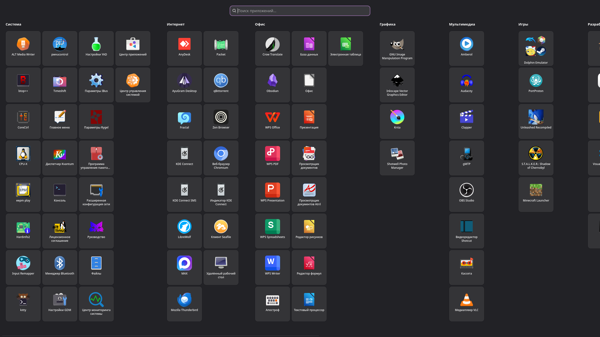

# ximper-shell-launcher

An application launcher for Ximper Shell, with tiles, folders, groups and an application list. Runs in Wayland sessions with layer-shell support, including **Niri** and **Hyprland**.

[Документация на русском](README_ru.md)

[](data/screenshots/launcher.png)

*Fullscreen mode with horizontal groups and a customized layout. Click the image for the full-size screenshot.*

## Features

- Fullscreen or floating menus: tiles, an application list, or both.
- All applications or just your launcher-pinned tiles.
- Resizable tiles, folders, named groups and drag-and-drop between them.
- Vertical groups or horizontal scrolling; groups can also be disabled.
- Application search and optional external search providers, up to four at once.
- Keyboard and gamepad navigation.
- Custom backgrounds and appearance.
- Optional pinning to Ximper Shell Dock, separate from launcher pinning.

## Quick start

```sh
ximper-shell-launcher --toggle       # Show or hide the menu; short form: -t
ximper-shell-launcher --reload       # Apply configuration changes
ximper-shell-launcher --list-presets # List ready-made layouts
```

Starting the launcher without options creates a hidden menu. Add it to your compositor's session startup and bind `ximper-shell-launcher --toggle` to a key. Autostart files and keybindings are not installed automatically. Commands control the already running launcher when there is one.

### Choose a preset

```sh
ximper-shell-launcher --preset 8.1
ximper-shell-launcher --preset 10
ximper-shell-launcher --preset ximper
ximper-shell-launcher --preset wofi
```

**Applying a preset replaces your current manual layout.** It generates a fresh layout from installed applications; there is no automatic restoration of the previous one. Search, wallpaper and monitor preferences are preserved.

| Preset | Appearance | Generated layout |
|---|---|---|
| `8.1` | Fullscreen tiles, horizontal groups | All applications grouped by category, without folders |
| `10` | Floating menu at the bottom left, list on the left | System and Internet tiles; other applications remain available in the list and search |
| `ximper` | Fullscreen tiles, without a list or group headings | Category folders and standalone applications |
| `wofi` | Compact floating list in the center | Application list; tiles are not displayed |

To apply a preset and also toggle the menu:

```sh
ximper-shell-launcher --preset 8.1 --toggle
```

The names are exactly `8.1`, `10`, `ximper` and `wofi`, without a `win` prefix. Presets are inspired by these layouts, not pixel-identical Windows themes. Applying a preset during a drag is not allowed.

## Using the launcher

### Tiles, folders and groups

- Click a tile to launch an application. Arrow keys move focus; Enter or Space activates a tile. Escape closes a context menu or the launcher.
- Open a tile's context menu to change its size, create a folder, or pin/unpin the application. Launcher pinning and Dock pinning are independent.
- Drag tiles and folders to change their order or move them between groups. Drop an application in the center of a folder to put it inside; use its edges to insert beside it.
- Open a folder to rearrange its applications or drag them out. A folder can also be converted into a group from its context menu.
- Hover a group heading, or focus its buttons with the keyboard, to rename the group, create a folder, or add a group with `+`.
- Drag an entry into the **New group** area after the last group to create a group. An empty tail of about half the visible tile area makes it accessible; holding a dragged tile near an edge scrolls automatically.
- Moving the last entry out removes the empty source group. Deliberately created empty groups stay available for additions. Cancelling a drag leaves the layout unchanged. Folder names within a group must differ; a move with a conflicting name is rejected.

Folders open in the scroll direction, smoothly making space for their contents: to the right in horizontal layouts and downward in vertical layouts.

In horizontal mode, tiles fill the available height and groups grow to the right. In vertical mode, groups follow one another downward. With groups disabled, folders remain available on one shared tile board; editing it saves a flat layout.

In **All applications** mode, unpinned applications still appear in the catalog. In **Pinned** mode, only your saved launcher tiles are shown. Applications remain available in the list and search either way.

### Search

Type in the search field to find applications by name, description, keywords or category. External providers can add their own results; their order is configurable. Up to four providers work at once, although a slow provider can delay new results.

While searching, previous results stay visible but cannot be launched. Each provider shows up to five results. Tiles mode shows up to eight matching applications; the list and combined modes do not have that limit. Click a provider heading to open its full search. Some results let you copy text to the clipboard.

### Gamepad

| Button | Action |
|---|---|
| D-pad / left stick | Navigate tiles, lists and menus |
| A | Launch or select |
| B | Go back: close a folder, context menu or launcher |
| X | Open the focused entry's context menu |
| Guide / Xbox | Toggle the launcher |
| LB / RB | Scroll |

Hold the D-pad or stick for continuous navigation. Guide does not toggle the menu while Steam is running. Start and Y have no assigned action.

## Settings

Presets are the quickest way to choose a layout. For individual settings, edit `~/.config/ximper-shell/launcher/config.json` and run `ximper-shell-launcher --reload`. If `XDG_CONFIG_HOME` is set, its directory is used instead of `~/.config`. There is no built-in settings window.

<details>
<summary>Configuration example and available settings</summary>

Merge the settings you need into your existing file; replacing the whole file can remove your tile layout.

```json
{
  "launcher_mode": "combined",
  "tile_mode": "pinned",
  "groups_enabled": true,
  "group_layout": "vertical",
  "app_list_side": "left",
  "window_mode": "floating",
  "floating_position": "bottom-left",
  "floating_width": 1000,
  "floating_height": 760,
  "search_providers_enabled": true,
  "search": {
    "providers": [
      { "id": "org.gnome.Nautilus.desktop", "enabled": true }
    ]
  }
}
```

| Setting | Default | Meaning |
|---|---|---|
| `launcher_mode` | `"tiles"` | `tiles`, `wofi` (list), or `combined` |
| `tile_mode` | `"all"` | `all` applications or only launcher `pinned` entries |
| `groups_enabled` | `true` | Show group headings and actions; false gives a shared board with folders |
| `group_layout` | `"vertical"` | `vertical` or `horizontal`; applies when groups are enabled |
| `app_list_side` | `"left"` | `left` or `right` in combined mode |
| `app_list_sort` | `"alphabetical"` | Browse list: `alphabetical` or `relevance` |
| `search_sort` | `"relevance"` | Matching applications: `relevance` or `alphabetical` |
| `max_columns` | `0` | Vertical-layout column limit; 0 chooses automatically. Horizontal groups grow as needed |
| `cell_size` | `0` | Tile cell size in pixels; 0 chooses automatically |
| `tile_icon_size` | `0` | Icon size in pixels, up to 128; 0 chooses automatically |
| `tile_square_labels` | `false` | Show centered application names on small square tiles, up to two lines |
| `window_mode` | `"floating"` | `floating` or `fullscreen` |
| `close_on_focus_loss` | `true` | Close a floating menu when it loses focus |
| `floating_position` | `"custom"` | `custom`, `center`, `top`, `bottom`, `left`, `right`, or a corner such as `bottom-left` |
| `floating_margin` | `16` | Edge margin for fixed positions, in pixels |
| `floating_width` / `floating_height` | `1120` / `880` | Floating menu size, in pixels |
| `floating_x_percent` / `floating_y_percent` | `50` / `50` | Position from 0 to 100 in `custom` mode |
| `output` | `[]` | Floating menu monitor connector names; only the first is used. Empty selects the active monitor |
| `layer` | `"overlay"` | Window layer: `background`, `bottom`, `top`, or `overlay` |
| `wallpaper_path` | `""` | Absolute path to a local background image; empty disables it |
| `wallpaper_fit` | `2` | Image sizing: 0 stretch, 1 contain, 2 cover, 3 scale down |
| `wallpaper_opacity` / `wallpaper_dim` | `100` / `0` | Background image opacity and darkening, 0–100% |
| `background_opacity` | `100` | Menu background opacity, 0–100%; use image settings instead when a wallpaper is enabled |
| `search_providers_enabled` | `true` | Enable external providers; application search remains available when false |
| `search.providers` | `[]` | Provider desktop IDs, order and `enabled` flags |
| `groups` | Generated from installed apps | Your saved tiles and folders; prefer editing through the menu |

Providers not listed in `search.providers` remain enabled and follow configured providers alphabetically. Disable an individual one with `"enabled": false`, or disable all external providers with `search_providers_enabled`.

`--describe` prints the current settings and available parameter information as JSON. It is a diagnostic output, not a replacement configuration file. `--preset` cannot be combined with `--describe`, `--reload` or `--list-presets`.

</details>

<details>
<summary>Opening and closing animations</summary>

Choose `none`, `fade`, `slide`, `zoom` or `pop` independently for opening and closing. The default is a slide from the top. For example:

```json
{
  "animation_open": {
    "effect": "slide",
    "slide": { "direction": "top", "duration_ms": 400 }
  },
  "animation_hide": { "effect": "fade", "fade": { "duration_ms": 180 } }
}
```

Slide directions are `left`, `right`, `top` and `bottom`. Fade, Slide and Zoom durations accept 0–2000 ms; 0 is immediate. Zoom and Pop scale is set with `scale_percent` (50–100). Pop also accepts `damping_percent` (30–200) and `stiffness` (50–1200). Use `none` to disable an effect. System-wide disabled animations are respected. Add these fields to the existing config and use `--reload`.

</details>

<details>
<summary>Custom appearance with CSS</summary>

Place your CSS in `~/.config/ximper-shell/launcher/style.css`. A starting point is the installed file `/etc/xdg/ximper-shell/launcher/style.css` or [`data/ximper-shell-launcher.css`](data/ximper-shell-launcher.css).

```css
.tile {
  border-radius: 16px;
}

.window-background {
  background: @window_bg_color;
}
```

Restart the launcher after changing CSS; `--reload` only reloads configuration and applications. GTK theme colors follow your system theme.

</details>

## Build and install

Requires a Wayland session with layer-shell support, Meson ≥ 0.62, Ninja, Vala, a C compiler, gettext tools and development packages for GTK ≥ 4.12, libadwaita ≥ 1.4, gtk4-layer-shell ≥ 1.0, json-glib, gio-unix, gdk-pixbuf and manette-0.2.

```sh
meson setup _build --prefix=/usr --sysconfdir=/etc
ninja -C _build
./_build/src/ximper-shell-launcher --toggle
```

Optional system installation, requiring write permissions to the installation directories:

```sh
meson install -C _build
```

Gamepad support is a build dependency. Dock and external search providers are optional. For ALT packaging, see [`ximper-shell-launcher.spec`](ximper-shell-launcher.spec).

## License

GPLv3 — see [LICENSE](LICENSE).
