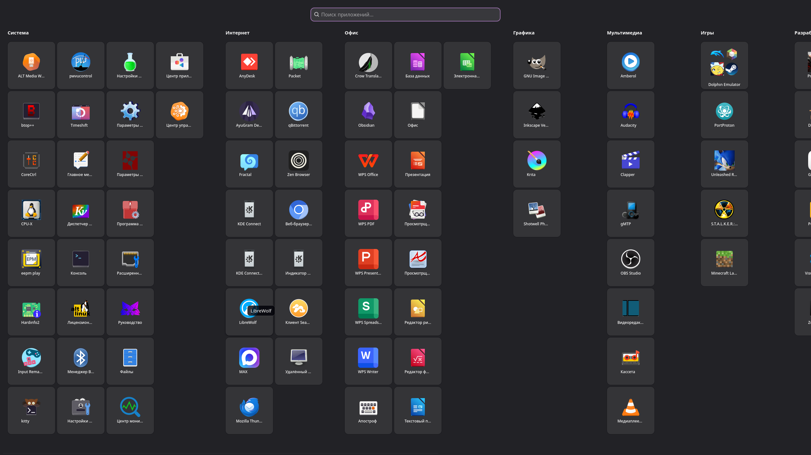

# ximper-shell-launcher

Лаунчер приложений для Wayland с плитками, папками и поиском. Компонент Ximper Shell для Niri и Hyprland.

[English](README.md)

[](data/screenshots/launcher.png)

*Полноэкранный режим с горизонтальными группами и настроенной раскладкой. Нажмите на изображение, чтобы открыть полный размер.*

## Возможности

- Три интерфейса: плитки, компактный список Wofi и комбинированный список с плитками.
- Полноэкранное или плавающее окно с выбором положения и монитора.
- Плитки разных размеров, папки и именованные вертикальные или горизонтальные группы.
- Перетаскивание для перестановки плиток, переноса между группами и наполнения папок.
- Все приложения или только закреплённые в лаунчере; четыре готовых пресета.
- Нечёткий поиск приложений и дополнительные результаты GNOME Search Providers.
- Управление с клавиатуры и геймпада; необязательная интеграция с Ximper Shell Dock.
- Фоновое изображение, прозрачность, анимации окна и пользовательские стили.

## Быстрый старт

В установленной системе выполните:

```sh
ximper-shell-launcher --toggle    # показать или скрыть меню (-t)
ximper-shell-launcher --reload    # применить изменения конфигурации
```

Запуск без параметров создаёт **скрытое** окно. Добавьте `ximper-shell-launcher` в автозапуск своей сессии, а `ximper-shell-launcher --toggle` привяжите к удобной клавише композитора. Готовые файлы автозапуска не поставляются.

### Выберите пресет

```sh
ximper-shell-launcher --list-presets
ximper-shell-launcher --preset 8.1
ximper-shell-launcher --preset 10
ximper-shell-launcher --preset ximper
ximper-shell-launcher --preset wofi
```

**Пресет заменяет ручную раскладку без подтверждения.** Сохранённых профилей и автоматического восстановления прежних групп нет; перед применением сохраните копию конфигурации, если хотите вернуться к ней.

| Пресет | Интерфейс и раскладка |
|---|---|
| `8.1` | Полноэкранные плитки с горизонтальными группами: все приложения по категориям, без автоматически созданных папок |
| `10` | Плавающее комбинированное меню внизу слева, список слева; закреплённые плитки в группах «Система» и «Интернет» |
| `ximper` | Полноэкранная плоская доска без групп; папки по категориям, отдельные плитки для остальных приложений |
| `wofi` | Компактный плавающий список по центру; плитки не показываются |

Состав зависит от установленных приложений. В пресете `10` остальные приложения доступны в списке и поиске. Пресеты задаются **командой**, а не ключом в `config.json`.

Применение само по себе не меняет видимость меню. Добавьте `--toggle`, чтобы одновременно переключить её:

```sh
ximper-shell-launcher --preset 8.1 --toggle
```

`--preset` нельзя совмещать с `--describe`, `--reload` или `--list-presets`.

## Управление

### Плитки, папки и группы

- Стрелки перемещают фокус, Enter или Space активируют выбранную плитку. Esc закрывает контекстное меню или лаунчер.
- Контекстное меню плитки позволяет менять размер, закреплять приложение в лаунчере и переносить его в группу. Закрепление в отдельном **Ximper Shell Dock** независимо и доступно, когда Dock запущен.
- Перетащите приложение в центр папки, чтобы добавить его внутрь; края папки служат для вставки рядом. В открытой папке можно менять порядок и вытаскивать приложения на доску.
- При наведении или фокусе на заголовке группы появляются действия: переименовать, создать пустую папку и добавить группу кнопкой `+`. Меню папки позволяет преобразовать её в группу.
- Во время перетаскивания после последней группы появляется зона «Новая группа». Отпустите там плитку или папку, чтобы создать группу и перенести элемент.

После последней группы оставлено свободное место примерно в половину видимой плиточной области. Удерживайте перетаскиваемый элемент у края области, чтобы прокрутить её. Отмена перетаскивания не меняет раскладку.

Группа, опустевшая после переноса последнего элемента, удаляется; специально созданная пустая группа сохраняется. Папки в одной группе должны иметь разные имена: перенос с совпадающим именем отклоняется.

При `groups_enabled: false` показывается плоская доска с папками без заголовков групп; редактирование сохраняет её как одну безымянную группу.

### Поиск

Начните вводить название, описание или ключевые слова приложения. Поиск и список содержат все приложения, даже если плитки показывают только закреплённые.

Внешние GNOME Search Providers добавляют результаты перед приложениями; до четырёх поставщиков работают параллельно. Медленный поставщик может задержать появление новых результатов. Нажатие на заголовок поставщика открывает полный поиск, а некоторые результаты позволяют скопировать текст в буфер обмена. Пока новый поиск не готов, прежние результаты остаются видимыми, но их нельзя запустить.

От каждого поставщика показывается до пяти результатов. В режиме плиток показывается до восьми найденных приложений; в Wofi и комбинированном режиме этого ограничения нет.

В комбинированном режиме поиск расширяет список поверх плиток; очистка запроса возвращает обычную раскладку.

### Геймпад

| Кнопка | Действие |
|---|---|
| D-pad / левый стик | Навигация по плиткам, спискам и меню |
| A (нижняя) | Запуск / выбор пункта |
| B (правая) | Закрыть папку, всплывающее меню или лаунчер |
| X (верхняя) | Контекстное меню выбранной плитки или локального приложения |
| Xbox / Guide | Показать или скрыть лаунчер |
| LB / RB | Прокрутка вверх / вниз |

Удерживайте D-pad или стик для непрерывной навигации. Guide не переключает лаунчер, пока работает Steam. Start и Y не назначены.

## Настройка

<details>
<summary>Конфигурация, внешний вид и анимации</summary>

Файл: `~/.config/ximper-shell/launcher/config.json`, либо `$XDG_CONFIG_HOME/ximper-shell/launcher/config.json`, если задан `XDG_CONFIG_HOME`. Встроенного окна настроек нет. После редактирования выполните `ximper-shell-launcher --reload`.

Добавьте нужные настройки в существующий файл, не заменяя его целиком: иначе можно потерять ручную раскладку. В примере идентификаторы приложений замените своими:

```json
{
  "launcher_mode": "combined",
  "tile_mode": "pinned",
  "group_layout": "vertical",
  "app_list_side": "left",
  "window_mode": "floating",
  "floating_position": "bottom-left",
  "groups": [{
    "name": "Избранное",
    "tiles": [{ "desktop_id": "org.gnome.Nautilus.desktop", "size": "small" }]
  }]
}
```

Основные параметры; отсутствующие скалярные настройки получают значения по умолчанию:

| Параметр | По умолчанию | Значение |
|---|---|---|
| `launcher_mode` | `"tiles"` | `tiles`, `wofi` или `combined` |
| `tile_mode` | `"all"` | `all` — все приложения; `pinned` — закреплённые в лаунчере |
| `groups_enabled` | `true` | Заголовки и действия групп; `false` — плоская доска |
| `group_layout` | `"vertical"` | `vertical` или `horizontal` с горизонтальной прокруткой |
| `app_list_side` | `"left"` | Список в combined: `left` или `right` |
| `app_list_sort` | `"alphabetical"` | Список без запроса: `alphabetical` или `relevance` по частоте запусков |
| `search_sort` | `"relevance"` | Поиск приложений: `relevance` или `alphabetical` |
| `cell_size` | `0` | Размер ячейки в пикселях; 0 — автоматически |
| `max_columns` | `0` | Предел столбцов вертикальной доски; 0 — автоматически |
| `tile_icon_size` | `0` | Размер иконок: 0 — автоматически, иначе 1–128 px |
| `tile_square_labels` | `false` | Показывать подписи квадратных плиток |
| `layer` | `"overlay"` | Слой окна: `background`, `bottom`, `top`, `overlay` |
| `window_mode` | `"floating"` | `floating` или `fullscreen` |
| `close_on_focus_loss` | `true` | Скрывать плавающее меню при потере фокуса |
| `floating_position` | `"custom"` | `custom`, `center`, `top`, `bottom`, `left`, `right` или углы `top-left`, `top-right`, `bottom-left`, `bottom-right` |
| `floating_margin` | `16` | Отступ от края для готовых положений, в пикселях |
| `floating_width` / `floating_height` | `1120` / `880` | Размер плавающего меню в пикселях |
| `floating_x_percent` / `floating_y_percent` | `50` / `50` | Положение `custom`: 0–100% доступного пространства |
| `output` | `[]` | Имена разъёмов мониторов, например `["DP-1"]`; для плавающего окна используется первый, иначе активный монитор |
| `wallpaper_path` | `""` | Абсолютный путь к фоновому изображению; пустая строка отключает его |
| `wallpaper_fit` | `2` | 0 — растянуть, 1 — вписать, 2 — покрыть, 3 — только уменьшать |
| `wallpaper_opacity` | `100` | Непрозрачность изображения, 0–100% |
| `wallpaper_dim` | `0` | Затемнение изображения, 0–100% |
| `background_opacity` | `100` | Непрозрачность фона меню, 0–100%; не действует при использовании изображения |
| `search_providers_enabled` | `true` | Внешние поставщики; `false` оставляет поиск приложений |
| `search.providers` | `[]` | Порядок поставщиков: записи с desktop-ID `id` и флагом `enabled` |
| `groups` | По установленным приложениям | Именованные группы с массивами `tiles` |

Размеры плиток: `small` (квадрат), `medium` (широкая), `large` (большая). Для папки используйте `size: "folder"`, `desktop_id: "folder:Имя"`, `folder_name` и массив desktop-ID `folder_items`.

Порядок записей `search.providers` задаёт порядок секций результатов. Не перечисленные поставщики остаются включёнными и идут после настроенных. Например, добавьте в конфигурацию:

```json
{
  "search": {
    "providers": [
      { "id": "org.gnome.Nautilus.desktop", "enabled": true },
      { "id": "org.gnome.Calculator.desktop", "enabled": false }
    ]
  }
}
```

### Анимации окна

`animation_open` и `animation_hide` независимо задают появление и скрытие. Эффекты: `none`, `fade`, `slide`, `zoom`, `pop`. По умолчанию — Slide от верхнего края и обратно, 400 мс; при появлении есть короткое пружинное завершение.

Добавьте нужные поля в существующую конфигурацию, не заменяя раскладку:

```json
{
  "animation_open": {
    "effect": "zoom",
    "zoom": { "scale_percent": 85, "duration_ms": 200 }
  },
  "animation_hide": {
    "effect": "slide",
    "slide": { "direction": "top", "duration_ms": 400 }
  }
}
```

Оба профиля поддерживают `fade.duration_ms`, `slide.direction` и `slide.duration_ms`, `zoom.scale_percent` и `zoom.duration_ms`, а также `pop.scale_percent`, `pop.damping_percent`, `pop.stiffness`. Направления Slide: `left`, `right`, `top`, `bottom`. Длительность — 0–2000 мс, масштаб — 50–100%; для Pop затухание — 30–200%, жёсткость — 50–1200. `none` отключает переход. Примените изменения через `--reload`.

### Пользовательский CSS

Создайте `~/.config/ximper-shell/launcher/style.css` (или тот же путь относительно `XDG_CONFIG_HOME`), например:

```css
.tile {
  border-radius: 16px;
}
```

После изменения CSS **перезапустите лаунчер**: `--reload` перечитывает конфигурацию, но не стили.

</details>

## CLI

Кроме `--toggle`, `--reload` и команд пресетов, доступна команда:

```sh
ximper-shell-launcher --describe
```

Она выводит текущие настройки и справочные сведения в JSON для инструментов. Это не готовый файл конфигурации: не копируйте весь вывод в `config.json`.

## Сборка и установка

Нужна Wayland-сессия с поддержкой layer-shell. Зависимости сборки: Meson ≥ 0.62, Ninja, Vala, компилятор C, gettext; пакеты разработки GTK ≥ 4.12, libadwaita ≥ 1.4, gtk4-layer-shell ≥ 1.0, json-glib, gio-unix, gdk-pixbuf и manette-0.2.

```sh
meson setup _build --prefix=/usr --sysconfdir=/etc
ninja -C _build
./_build/src/ximper-shell-launcher --toggle
# Необязательная системная установка:
meson install -C _build
```

Системная установка требует прав записи в соответствующие каталоги. Dock и внешние поставщики поиска необязательны для использования лаунчера.

## Лицензия

GPLv3 — см. [LICENSE](LICENSE).
